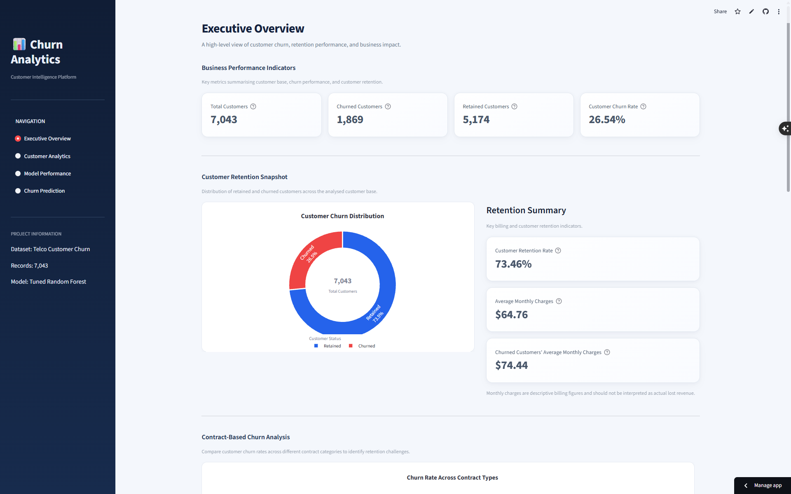
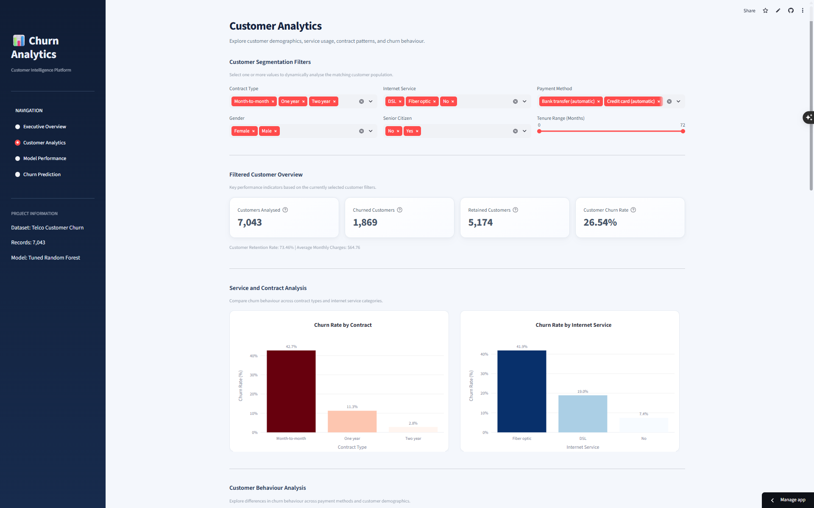
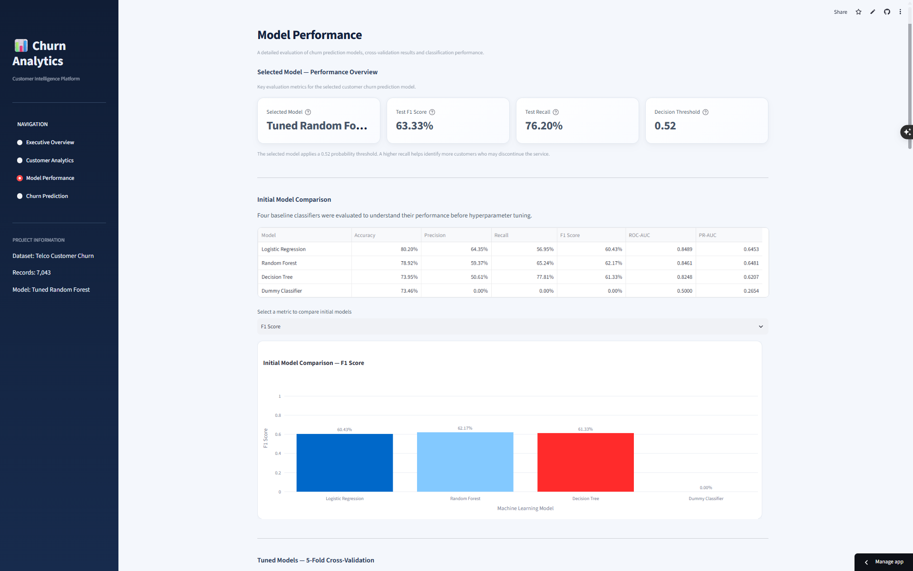

# Customer Churn Prediction & Intelligence Dashboard

An end-to-end Machine Learning project that predicts customer churn risk using customer demographics, subscribed services, contract details, and billing information. The project combines a tuned Random Forest classification pipeline with an interactive Streamlit dashboard for customer analytics, model evaluation, and batch churn prediction.

**[Live Dashboard](https://customer-churn-prediction-yv.streamlit.app) · [GitHub Repository](https://github.com/vashishthayash683-cell/Customer-Churn-Prediction)**

---

## Project Overview

Customer churn occurs when customers discontinue a company's products or services. Identifying customers who may be likely to leave can help businesses investigate retention opportunities and make more informed decisions.

This project develops an end-to-end churn prediction workflow using the Telco Customer Churn dataset. It covers exploratory data analysis, feature preprocessing, model comparison, cross-validation, hyperparameter tuning, decision-threshold selection, model evaluation, and deployment.

The trained model is integrated into an interactive Streamlit application that supports customer analytics and batch predictions from uploaded CSV files.

## Key Features

- **Exploratory Data Analysis:** Analyze customer demographics, service subscriptions, contracts, billing, and churn patterns.
- **Machine Learning Pipeline:** Apply categorical encoding and numerical feature scaling through a reusable preprocessing pipeline.
- **Model Comparison:** Evaluate Logistic Regression, Decision Tree, Random Forest, and a Dummy Classifier baseline.
- **Hyperparameter Tuning:** Optimize classification models using cross-validation.
- **Threshold Optimization:** Use a selected decision threshold of 0.52 for churn classification.
- **Customer Analytics Dashboard:** Explore customer characteristics and churn patterns interactively.
- **Model Performance Dashboard:** Review classification metrics and model evaluation results.
- **Batch Prediction:** Upload a customer CSV to generate churn probabilities, predicted labels, and risk categories.
- **Reusable Inference Module:** Run predictions through a standalone Python script.
- **Live Deployment:** Access the application through Streamlit Community Cloud.

## Live Demo

**[Launch the Customer Churn Intelligence Dashboard](https://customer-churn-prediction-yv.streamlit.app)**

The application contains four main pages:

1. Executive Overview
2. Customer Analytics
3. Model Performance
4. Churn Prediction

The Churn Prediction page supports CSV uploads for batch inference and provides downloadable prediction results.

## Dashboard Preview

<!-- Add your actual dashboard screenshots to the screenshots/ directory and uncomment the relevant sections below. -->

<!--
### Executive Overview


### Customer Analytics


### Model Performance


### Churn Prediction

-->

## Dataset

| Property | Details |
|---|---|
| Dataset | Telco Customer Churn |
| Source file | `data/Telco_customer_churn.xlsx` |
| Records | 7,043 |
| Original columns | 33 |
| Target variable | `Churn Label` |
| Positive class | `Yes` — Churn |
| Churn prevalence | Approximately 26.54% |

The target distribution is imbalanced: approximately 73.46% of customers did not churn, while 26.54% did.

To reduce data leakage, identifiers, geographic fields, and churn-related fields unavailable or inappropriate for the intended prediction setup were excluded from the model features. The final feature set contains 19 predictors.

## Technology Stack

| Category | Technologies |
|---|---|
| Programming language | Python |
| Data manipulation | Pandas, NumPy |
| Machine Learning | Scikit-learn |
| Data visualization | Matplotlib, Seaborn, Plotly |
| Interactive dashboard | Streamlit |
| Model serialization | Joblib |
| Excel data support | OpenPyXL |
| Development environment | Jupyter Notebook, VS Code |
| Version control | Git, GitHub |
| Deployment | Streamlit Community Cloud |

## Machine Learning Workflow

1. **Data loading and inspection:** Examine dataset dimensions, data types, missing values, and target distribution.
2. **Exploratory data analysis:** Investigate customer segments and relationships between customer attributes and churn.
3. **Feature selection:** Exclude identifiers, geographic information, and churn-related leakage features.
4. **Train-test split:** Create a stratified training and test split to preserve the target distribution.
5. **Preprocessing:** Apply One-Hot Encoding to categorical features and StandardScaler to numerical features.
6. **Baseline evaluation:** Establish a Dummy Classifier baseline.
7. **Model comparison:** Evaluate Logistic Regression, Decision Tree, and Random Forest.
8. **Cross-validation:** Compare candidate models using stratified five-fold cross-validation.
9. **Hyperparameter tuning:** Use GridSearchCV for Logistic Regression and RandomizedSearchCV for Random Forest.
10. **Threshold selection:** Compare candidate decision thresholds using out-of-fold predictions.
11. **Model evaluation:** Examine Accuracy, Precision, Recall, F1-score, ROC-AUC, and PR-AUC.
12. **Model interpretation:** Inspect Random Forest feature importances.
13. **Model serialization:** Save the fitted preprocessing and prediction pipeline using Joblib.
14. **Deployment:** Integrate the pipeline into a Streamlit dashboard and a reusable prediction script.

### Model Preprocessing

The final pipeline uses:

- `OneHotEncoder(handle_unknown="ignore")` for categorical features.
- `StandardScaler` for numerical features.
- A fitted Random Forest classifier for churn prediction.

The preprocessing steps are included in the saved pipeline so that incoming customer data receives the same transformations used during training.

## Model Selection

The following models were evaluated:

- Dummy Classifier
- Logistic Regression
- Decision Tree
- Random Forest

The tuned Random Forest was selected based primarily on its five-fold cross-validation F1-score.

| Model | Cross-validation F1-score |
|---|---:|
| Tuned Random Forest | 0.6490 |
| Tuned Logistic Regression | 0.6419 |

The selected Random Forest configuration used 250 trees, a maximum depth of 10, a minimum of 2 samples per leaf, a minimum of 10 samples for a split, square-root feature selection, and balanced class weights.

The selected decision threshold is **0.52**.

## Model Performance

The selected tuned Random Forest achieved the following results on the project test split at threshold 0.52.

| Metric | Test score |
|---|---:|
| Accuracy | 76.58% |
| Precision | 54.18% |
| Recall | 76.20% |
| F1-score | 63.33% |
| ROC-AUC | 0.8532 |
| PR-AUC | 0.6696 |

### Confusion Matrix

| Actual / Predicted | No Churn | Churn |
|---|---:|---:|
| Actual No Churn | 794 | 241 |
| Actual Churn | 89 | 285 |

The model identified 285 actual churners in the test split, while 89 actual churners were missed. It also flagged 241 customers who did not churn.

These results illustrate the trade-off between identifying potential churners and generating false-positive alerts.

**Evaluation limitation:** The test set was used in earlier model comparisons. Consequently, these figures should be interpreted as an evaluation estimate rather than a completely untouched final test result. A future improvement is to reserve an independent final test set or use a time-based evaluation strategy.

## Model Explainability

The Random Forest feature-importance analysis highlighted the following influential features:

| Feature | Importance |
|---|---:|
| Month-to-month contract | 0.1218 |
| Tenure Months | 0.1177 |
| Total Charges | 0.0887 |
| Two-year contract | 0.0641 |
| Monthly Charges | 0.0611 |

These values represent the model's relative feature importance, not the probability of churn or a causal effect.

The findings can help guide further analysis of contract types, customer tenure, and billing patterns. They should not be interpreted as proof that a particular customer characteristic causes churn.

## Project Architecture

```text
Customer-Churn-Prediction/
│
├── dashboard/
│   └── app.py
│
├── data/
│   └── Telco_customer_churn.xlsx
│
├── notebooks/
│   ├── customer_churn_analysis.ipynb
│   ├── sample_customers.csv
│   ├── test_invalid_customers.csv
│   └── models/
│       ├── tuned_random_forest_churn_pipeline.joblib
│       └── model_metadata.json
│
├── src/
│   └── predict.py
│
├── reports/
│
├── requirements.txt
├── .gitignore
└── README.md
```

Generated prediction reports are excluded from version control. The model artifacts and sample input files are included in the repository.

## Getting Started

### Prerequisites

- Python 3.13
- Git
- A terminal or command prompt

### 1. Clone the repository

```bash
git clone https://github.com/vashishthayash683-cell/Customer-Churn-Prediction.git
cd Customer-Churn-Prediction
```

### 2. Create a virtual environment

**Windows PowerShell:**

```powershell
python -m venv .venv
.\.venv\Scripts\Activate.ps1
```

If PowerShell blocks activation, use Command Prompt or activate the environment using the appropriate command for your shell.

### 3. Install dependencies

```bash
python -m pip install -r requirements.txt
```

### 4. Run the Streamlit dashboard

```bash
python -m streamlit run dashboard/app.py
```

Streamlit will provide a local URL in the terminal, typically `http://localhost:8501`.

## Running Batch Predictions

The repository includes a reusable prediction script at `src/predict.py`.

Run the script with the supplied sample customer data:

```bash
python src/predict.py --input notebooks/sample_customers.csv
```

The script loads the saved model artifacts, validates the input, and generates predictions.

The default output location is:

```text
reports/churn_predictions.csv
```

The output includes the predicted churn probability, predicted class, human-readable prediction label, and risk category.

**Input requirements:** The CSV must contain the 19 required model features with compatible column names and data types. Use `notebooks/sample_customers.csv` as a reference for the expected input schema.

## Business Value

The project demonstrates how customer-level data can support churn-risk analysis and retention planning.

Potential business applications include:

- Identifying customers who may need retention outreach.
- Exploring churn patterns across contracts and customer segments.
- Prioritizing customers for further investigation.
- Supporting data-driven customer retention experiments.
- Monitoring classification performance and prediction outputs.

Predictions should support, rather than replace, business judgment. The model does not guarantee that a flagged customer will churn, and its predictions should be validated before being used for operational decisions.

## Limitations

- The model is trained on a specific Telco Customer Churn dataset and may not generalize to other businesses without validation.
- The test set was used during earlier model comparisons, limiting its independence as a final evaluation set.
- Feature importance indicates model associations rather than causation.
- Predicted probabilities and risk categories require validation and calibration before high-stakes business use.
- Model performance may change when customer behavior, services, or pricing patterns change.

## Future Improvements

- Evaluate the model on a completely untouched test set or a time-based holdout.
- Assess probability calibration and threshold selection using business costs.
- Monitor prediction drift and model performance over time.
- Add cost-based retention prioritization and explainability tools.
- Evaluate performance across relevant customer segments.
- Add automated tests and continuous integration.
- Extend the dashboard with validated business impact estimates.

## Author

**Yash Vashishtha**

B.Tech — Computer Science and Information Technology

**Project:** Customer Churn Prediction & Intelligence Dashboard

**Links:** [GitHub Repository](https://github.com/vashishthayash683-cell/Customer-Churn-Prediction) · [Live Application](https://customer-churn-prediction-yv.streamlit.app)
